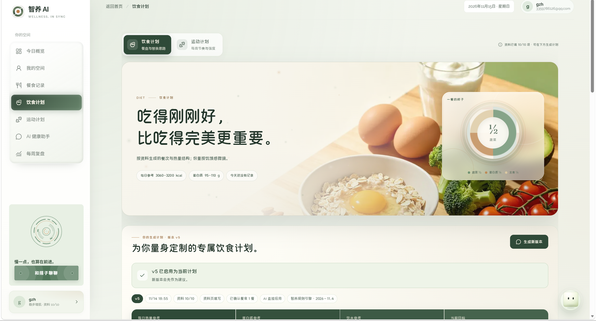
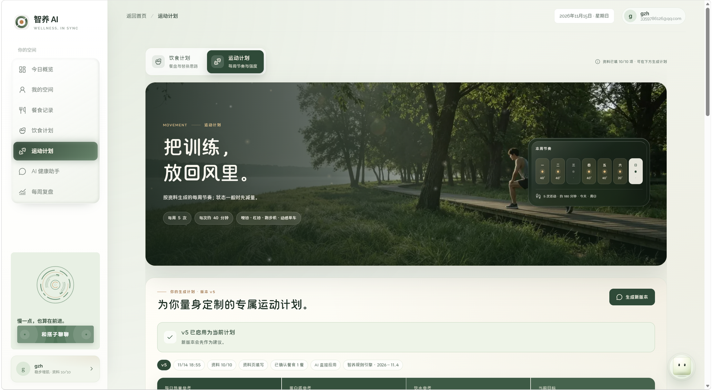
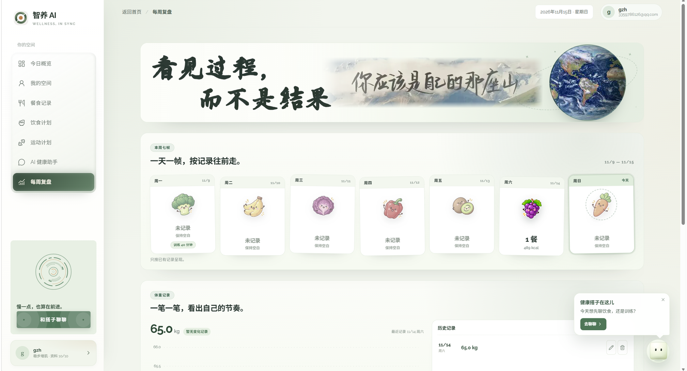
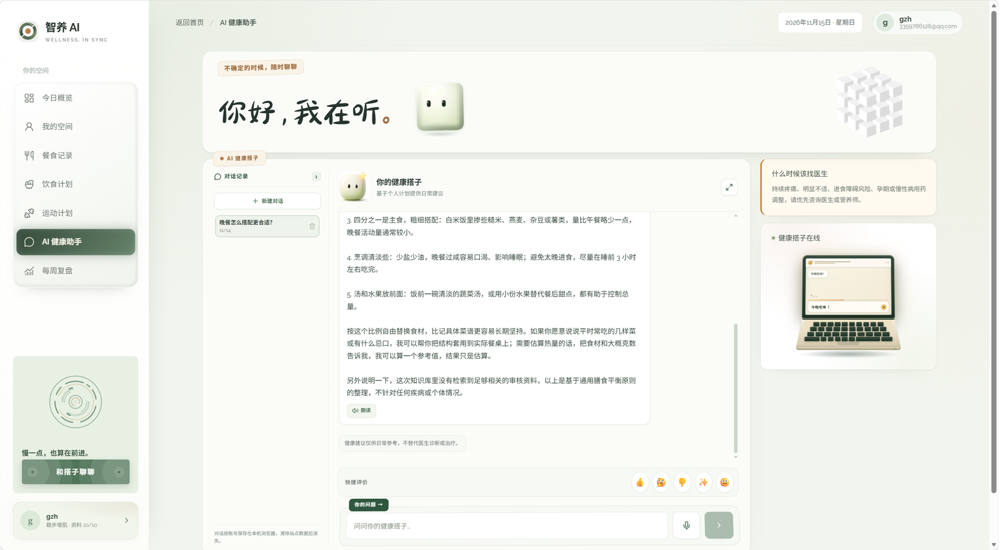
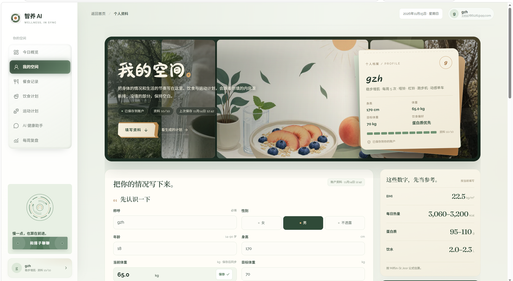

# 智养AI 项目介绍

## 一、项目详情及使用方式

### 1.1 项目概况

| 项目     | 内容                                                                |
|--------|-------------------------------------------------------------------|
| 项目名称   | 智养AI（zhiyang-ai）                                                  |
| 当前版本   | v1.0.0                                                            |
| 技术形态   | Next.js 16 全栈 Web 应用，App Router + Route Handlers，SSE 流式输出，桌面与移动端响应式 |
| 前端技术   | React 19、TypeScript 5.9、Tailwind CSS 4、Framer Motion、GSAP、ECharts |
| 服务端    | Next.js Route Handlers、AI SDK 7、MCP Client/Server                 |
| 数据存储   | MySQL 8                                                           |
| 身份认证   | Auth.js 5，邮箱密码登录，JWT 会话                                           |
| 模型服务   | DeepSeek flash/pro、Qwen 视觉模型、text-embedding-v4（1024 维）、Open-Meteo |
| 运行环境   | 阿里云 ECS，Node.js 24，systemd 常驻                                     |
| 公网访问地址 | http://116.62.42.146:3100                                         |
| 演示账号   | 3359786126@qq.com                                                 |
| 演示密码   | 11111111                                                          |
| 本地访问   | 解压文件夹后，双击启动智养AI.bat                                               |
| 代码结构   | 23 个 Route Handlers、37 个领域模块、9 个数据模型                              |

### 1.2 项目简介

智养AI 把日常饮食、训练和体重管理放在同一套资料与记录之上，按「记录 → 计划 → 执行 → 复盘 → 调整」组织功能。用户不需要在多个应用之间搬运数据：餐食、训练与体重记录进入复盘，计划根据资料生成，出现显著偏差时再由系统提出调整。

系统把计算与生成分开：营养目标、餐次区间、训练排程与偏差阈值由规则引擎完成；模型负责理解输入、组织建议与对话，不能改写计算结果。每次生成与调整都会形成计划版本，历史版本可以回看、启用或删除。

智养AI 提供一般健康信息与生活建议，不做疾病诊断，不替代医生处方。没有记录时保持空白或明确说明，不用推测数据填充图表和结论。

### 1.3 功能详情

**（1）餐食记录**

- 拍照或上传图片，视觉模型识别菜品与份量，结构化模型输出营养 JSON。
- 与食物参考库匹配，补全每 100g 参考值后按克数换算，给出热量与三大营养素区间。
- 识别结果可修改，用户确认后才写入记录；概览与复盘只读取已确认记录。
- 识别失败时提示重试或手动录入，不生成占位数据。

**（2）饮食计划**

- 按性别、年龄、身高、体重、活动量与目标计算基础代谢、能量目标、营养素与餐次区间。
- 受约束 Agent 在白名单工具内补充建议，包含「蛋白质重点」「份量重点」等可执行提示。
- 生成结果写入 PlanVersion，新版本默认启用，历史版本可回看、启用、删除。
- 支持多轮对话修订，只描述实际变化，实测约 4.5 秒。

**（3）运动计划与打卡**

- 按可用器械、训练天数与单次时长排训练日与动作。
- 训练卡逐项勾选，全部步骤完成才记一次训练；示例与未来日期不可打卡。
- 周复盘同步训练完成记录，与餐食偏差信号一起构成动态调整输入。

**（4）每周复盘与体重趋势**

- 汇总餐食偏差、训练完成与体重记录。
- 体重同日记录覆盖，单条记录即出图，同值也显示，平线使用局部刻度避免误导。
- 趋势只读取真实记录，没有记录时不画图。

**（5）健康搭子**

- 多会话流式对话，回答引用知识库片段，绑定标题、来源与序号。
- 语音经 Web Speech 入框后可编辑，播报逐条朗读、可随时停止。
- 点赞与点踩写入 Feedback 表；浮动头像可拖拽，气泡悬停或聚焦时再次显示。

**（6）首页概览**

- 今日热量与饮水、今日训练卡、九宫格入口与体重趋势集中在首屏。
- 今日训练卡只读已启用计划，分训练、休息、未启用三种状态。
- 九宫格切片可点击跳转，悬停凸起、其余模糊，减弱动效下全部降级。

**（7）我的空间与账户**

- 维护健康资料、体重与城市；体重同步概览与复盘。
- 邮箱密码注册登录，bcrypt 哈希与 30 天 JWT 会话。
- 免注册体验使用独立会话沙盒，数据只存在进程内，与账号数据互不读写。

### 1.4 使用方式

**在线部署**
- **访问地址**：http://116.62.42.146:3100
- **演示账号**：3359786126@qq.com
- **演示密码**：11111111
- 使用演示账号密码登陆或者注册新账号
1. 在「我的空间」填写性别、年龄、身高、体重、活动量、目标、器械与城市。
2. 在餐食记录拍照或手动记录一餐，确认识别与份量后入库。
3. 生成饮食与运动计划，按周执行；训练卡逐项勾选。
4. 在每周复盘查看餐食偏差、训练完成与体重趋势，必要时确认临时调整。
5. 需要解释或建议时，打开健康搭子提问，回答带引用来源。
- **运行环境**：阿里云 ECS，Node.js 24，MySQL 8，systemd 常驻。
- **构建与启动**：`prisma generate && next build`，`next start` 监听 3100 端口。
- **环境变量**：`AUTH_SECRET`、`DATABASE_URL`、`OPENAI_*`、`EMBEDDING_*`、`PLAN_MODEL` 等在服务器环境注入；生产环境设置 `DEMO_MODE="false"`。
- **数据**：MySQL 与业务同机；迁移使用独立账号，运行时账号只授予业务表权限。
- **环境分离**：本地开发与公网 ECS 分开部署，计划版本与代码快照可回退。

## 二、项目的亮点

### 2.1 技术亮点

1. **确定性引擎 + 受约束 Agent**：营养目标、餐次区间、训练排程与偏差阈值由规则引擎计算；Agent 只能调用 6 个白名单工具补充建议，越界调用返回 REJECTED。
2. **混合检索 + 引用 + 评测**：向量与 BM25 双路召回、重排后带片段序号与来源回链；43 条评测集覆盖三种检索策略。
3. **多模态餐食识别**：视觉模型识别菜品与份量，结构化模型输出营养 JSON；结果带区间与误差提示，确认后才入库。
4. **流式输出安全**：SSE 流按句缓冲，命中自伤、用药、诊断、就医淡化四类规则时替换为保守表述，并追加免责声明。
5. **MCP 工具链**：知识检索、营养估算、安全核对、天气查询 4 个工具，经 `/api/mcp` 暴露，助手以真实 MCP Client 调用。
6. **真实记录驱动**：概览、复盘与动态调整只读取已确认记录；没有记录时不出图、不给结论，不用推测数据填充。

### 2.2 应用亮点

1. **计划可回退**：每次生成与调整形成 PlanVersion，历史版本可回看、启用、删除。
2. **动态调整有边界**：单餐 max(180 kcal, 30%)、全天 max(150 kcal, 10%) 阈值触发；临时调整按天覆盖，不占版本号，可 apply / restore。
3. **免注册体验**：新用户可在会话沙盒中体验完整流程，数据只存在进程内，与账号数据互不读写。
4. **低刺激视觉与无障碍**：白瓷底色、鼠尾草绿主色、克制动效；正文对比度 12.3:1，支持减弱动效，移动端输入框避开底部导航。

## 三、AI 测试技术落地使用情况概述

### 3.1 模型与能力落地

| 场景 | 模型/服务 | 落地方式 |
| --- | --- | --- |
| 对话助手 | DeepSeek flash（关闭思考） | SSE 流式回答，首句延迟优先 |
| 计划生成 | DeepSeek pro（开启思考） | 读取资料、餐食汇总、天气与指南，生成计划建议 |
| 餐食识别 | Qwen 视觉模型 | 图片识别菜品与份量 |
| 餐食结构化 | DeepSeek flash | 输出严格 JSON，交食物库与校验 |
| 向量检索 | text-embedding-v4（1024 维） | 知识库片段向量化与混合检索 |
| 天气 | Open-Meteo | 1–3 天预报，失败时明确报错，不编造 |

### 3.2 受约束计划 Agent

计划分两段生成：`lib/plan-engine.ts` 先计算基础代谢、能量目标、三大营养素与训练排程；Agent 只能调用 6 个白名单工具补充建议（餐食汇总、营养目标、天气、指南检索、重点标记、教练说明），`stepCountIs(8)`、`maxOutputTokens 1600`、`temperature 0.2`。重点标记必须有对应汇总信号，至多一项，不修改热量目标；越界调用返回 REJECTED 并记录。

### 3.3 RAG 检索

知识库共 27 篇文档、62 个片段，来源包括中国居民膳食指南、健康中国行动、身体活动与睡眠指南，以及 BMJ、BJSM、Circulation 等同行评审文献。混合检索先从向量和 BM25 各取前 N 个片段，再按向量、BM25、词覆盖、短语与标题命中的权重合并排序；向量不可用时切换关键词策略。回答引用绑定片段序号与来源，没有足够相关内容时返回 NO_MATCH。

评测集 43 条（39 条正向、4 条域外负向），hybrid 与 vector 的 Hit@3、Hit@5 均为 100%，MRR 0.987，平均 23 ms；关键词策略命中 94.9%。

| 策略 | Hit@3 | Hit@5 | MRR | 平均耗时 |
| --- | --- | --- | --- | --- |
| hybrid | 100% | 100% | 0.987 | 23 ms |
| vector | 100% | 100% | 0.987 | 23 ms |
| keyword | 94.9% | 94.9% | 0.949 | 23 ms |

当前数据集上 hybrid 与 vector 指标相同，q05、q16 两条口语化问题关键词策略无法命中，hybrid 与 vector 可以；混合检索的价值在互补召回与降级可用。

### 3.4 多模态餐食识别

图片压缩后交给视觉模型识别菜品与份量，结构化模型输出营养 JSON，再匹配食物库补全参考值并按克数换算。结果带区间与误差提示，确认后才写入记录；单次全链路约 8.8 秒。

### 3.5 MCP 工具链

四个工具注册在 `lib/mcp-server.ts`，通过 `/api/mcp` 暴露：知识检索、营养估算、安全核对、天气查询。助手以 MCP Client 调用，工具可以独立冒烟测试。

### 3.6 输出安全

输入侧检查急症、自伤、疾病诊断与用药、特殊人群表述；输出侧在 SSE 流上按句缓冲，命中四类规则时替换为保守表述，并追加「以上为一般健康信息，不能替代医生的诊断和处方。」规则为确定性正则，含否定识别，不调用第二次模型，`post_guard` 记录结果。

### 3.7 测试与可观测性

- `npm run typecheck` 与 `npm run lint` 保持 0 error；5 条 img 警告为已接受的 Next.js 图片提示。
- `npm run rag:eval` 对 43 条问题运行三种检索策略，报告写入 `.rag-eval/last-report.json`。
- 浏览器回归覆盖 1440、1415、390 三档视口，关键链路在本地 dev 完成验收。
- `.ai-logs/ai-YYYY-MM-DD.jsonl` 记录模型、耗时、工具序列、usage、finishReason 与 `post_guard`，不保存提示词全文。

## 四、项目中涉及的关键技术

### 4.1 前端技术

- Next.js 16（App Router / React Server Components / Route Handlers）
- React 19 + TypeScript 5.9
- Tailwind CSS 4 + shadcn/ui 组件结构
- Framer Motion、GSAP、ECharts 6
- Web Speech API（语音输入与播报）

### 4.2 服务端与数据

- 23 个 Route Handlers，覆盖认证、资料、餐食、计划、调整、训练、体重、助手、MCP 与评测。
- AI SDK 7：`streamText`、`generateObject`、`embed` 与工具调用。
- MCP Client/Server 2.4：工具注册、调用与 `/api/mcp` 端点。
- Auth.js 5 + bcryptjs：登录与会话。
- Prisma 7 + MySQL 8：业务数据与知识片段。
- Zod 4：请求与工具参数校验。

### 4.3 AI 服务

- 对话：DeepSeek flash，关闭思考，首句延迟优先。
- 计划：DeepSeek pro，开启思考，处理多约束规划。
- 餐食：Qwen 视觉模型识别，DeepSeek flash 转结构化 JSON。
- 检索：text-embedding-v4，1024 维，可切换同维 bge-m3。
- 天气：Open-Meteo，支持 1–3 天预报。

### 4.4 核心模块

1. `lib/plan-engine.ts`：营养目标与训练排程。
2. `lib/plan-agent.ts`：受约束 Agent 与工具白名单。
3. `lib/plan-adjustment.ts`：偏差评估与临时调整。
4. `lib/rag.ts`：混合检索、重排与 NO_MATCH。
5. `lib/ai-safety.ts`：输入闸门与输出后置校验。
6. `lib/meal-vision.ts`：餐食识别流水线。
7. `lib/mcp-server.ts` / `mcp-client.ts`：MCP 工具与调用。
8. `lib/ai-logger.ts`：请求日志与工具序列。

### 4.5 工程化与部署

- Route Handlers、领域模块与数据访问分层，共享类型与校验集中定义。
- `prisma generate && next build` 构建，`next start` 运行，systemd 常驻。
- 环境变量注入密钥；数据库迁移使用独立账号，运行时账号只授予业务表权限。
- 计划版本与 git 快照提供行为与代码两级回退。

## 五、项目相关的图片/照片

以下为项目当前运行界面截图，顺序为：首页、餐食记录、饮食计划、运动计划、登录、每周复盘、健康搭子、我的空间。

**首页：品牌主视觉与今日入口**

**餐食记录：拍照识别、份量估算与今日记录**

**饮食计划：目标区间与计划版本**

**运动计划：每周节奏与训练安排**

**登录页：邮箱密码登录与注册**

**每周复盘：餐食、训练与体重趋势**

**健康搭子：流式回答、引用来源与语音**

**我的空间：健康资料、目标与身体数据**

项目界面使用的原始素材存放在 `public/`，通过 Next.js 静态资源与 `next/image` 加载：

| 目录 | 用途 | 文件示例 |
| --- | --- | --- |
| `public/images/hero/` | 首页 Hero 背景 | `zhiyang-hero-garden.webp`、`zhiyang-hero-meadow.webp` |
| `public/images/landing/` | 各功能模块示意与照片 | `meal-arch.webp`、`diet-plan-journal.webp`、`exercise-plan.webp` |
| `public/images/meals/` | 餐食与营养科普素材 | `meal-cover.webp`、`nutrition-basics.webp` |
| `public/images/plans/` | 计划页主视觉 | `plan-diet-hero.webp`、`plan-exercise-hero.webp` |
| `public/images/auth/` | 登录页背景 | `auth-table.webp`、`auth-mountain.webp` |
| `public/images/review/` | 每周复盘素材 | `review-earth.jpg`、`review-heading-mountain.webp` |
| `public/brand/` | 品牌图标与头像 | `cochi-avatar.png`、`zhiyang-icon.png` |
| `public/fonts/` | 品牌字体 | `lemi-xiaoyu.woff2`、`lemi-muhe-yuanti.woff` |

## 六、项目之前是否发表过或获奖

截至本次提交，本项目未在其他比赛或期刊发表，也未获得奖项；本次为首次参赛作品。

## 七、若项目是在其他项目基础上优化，请说明优化部分

本项目**不是**在其他项目基础上优化，也没有复用其他项目的业务代码。

## 附录 A：开发日志与版本记录

### 当前进度

- ✅ 核心功能与 AI 链路完成：餐食记录、饮食与运动计划、动态调整、训练打卡、每日/每周复盘、体重趋势、健康搭子、MCP 工具与输出安全。
- ✅ 公网部署完成：阿里云 ECS、Node.js 24、MySQL 8、systemd 常驻，访问地址 http://116.62.42.146:3100。
- ✅ 文档完成：技术文档、README、项目介绍与初期代码归档。
- ⏳ 后续计划：视频模态、检索扩展、红队评测、PWA 离线与长期记忆。

### 版本记录

- v01 · 2026-11-03 · 首个 Next.js 应用骨架
- v02 · 2026-11-03 · 饮食与运动计划页
- v03 · 2026-11-04 · 我的空间与资料模型
- v04 · 2026-11-04 · 首页 Hero 与餐食/助手交互
- v05 · 2026-11-05 · 计划引擎、食物库与图像识别
- v06 · 2026-11-05 · Prisma 数据层与 RAG 知识库
- v07 · 2026-11-06 · 食物指南、胶片相机与聊天体验
- v08 · 2026-11-07 · 长滚动首页与 Originkit Hero
- v09 · 2026-11-08 · 3D 照片球与首页视觉
- v10 · 2026-11-08 · 账号体系与受约束计划 Agent
- v11 · 2026-11-10 · 健康搭子聊天体验打磨
- v12 · 2026-11-10 · 切换到 MySQL 数据层
- v13 · 2026-11-10 · 计划修订对话与版本管理
- v14 · 2026-11-11 · 计划调整对话与安全边界
- v15 · 2026-11-12 · 天气数据与临时调整层
- v16 · 2026-11-12 · 体重记录与复盘趋势
- v17 · 2026-11-12 · 流体标题与复盘视觉
- v18 · 2026-11-13 · RAG 评测与回答引用
- v19 · 2026-11-13 · MCP 工具链与助手餐食读取
- v20 · 2026-11-13 · 独立登录页、资料城市与天气进计划
- v21 · 2026-11-13 · 清理废弃遗留过期文件
- v22 · 2026-11-14 · 训练打卡、体重编辑与计划预览同步
- v23 · 2026-11-15 · 项目细节优化

> v01–v23 为开发快照编号；当前发布版本为 v1.0.0。

### 后续计划

1. 视频模态：训练动作短视频的要点提示与计数。
2. 检索扩展：评测集扩充到数百条，引入向量索引与在线命中率监控。
3. 安全评测：建立红队用例库，对输入闸门与输出规则做系统性评测。
4. 多端与离线：PWA 离线记录、联网合并。
5. 长期记忆：在隐私边界内保存用户偏好与历史反馈。

## 附录 B：材料索引

| 材料 | 位置 |
| --- | --- |
| 技术文档 | `docs/智养AI技术文档.docx` |
| 项目 README | `README.md` |
| RAG 使用说明 | `docs/rag-guide.md` |
